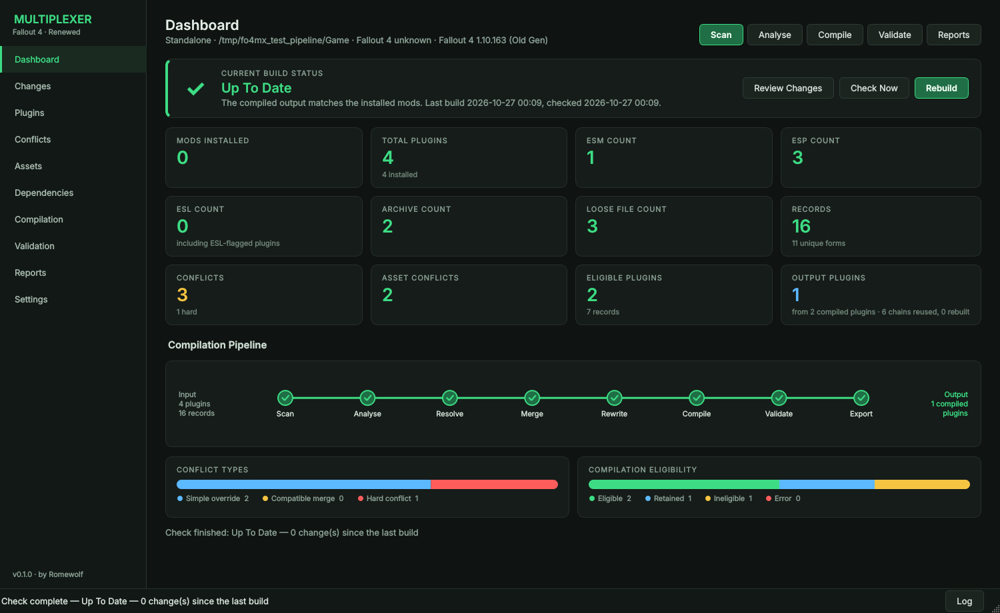
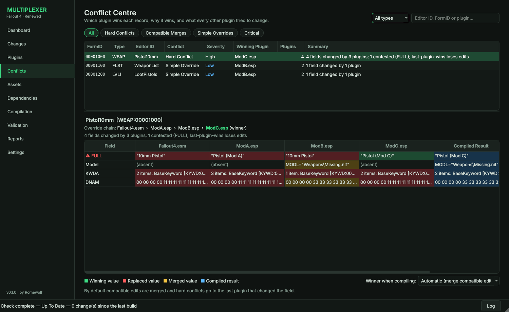
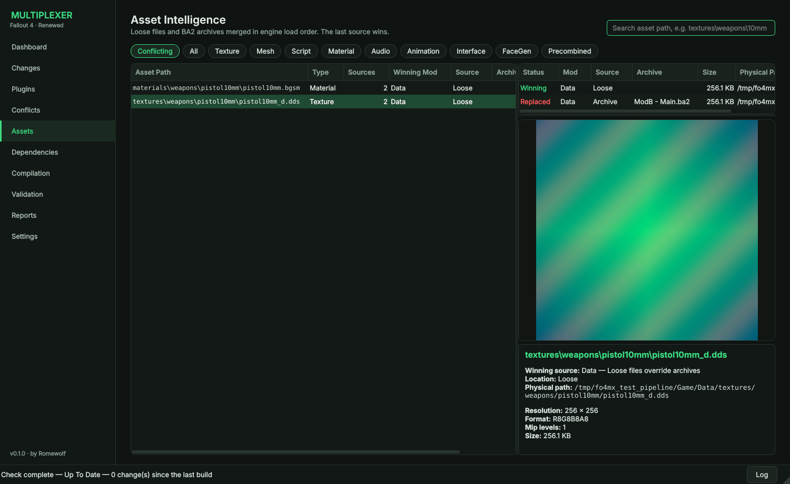
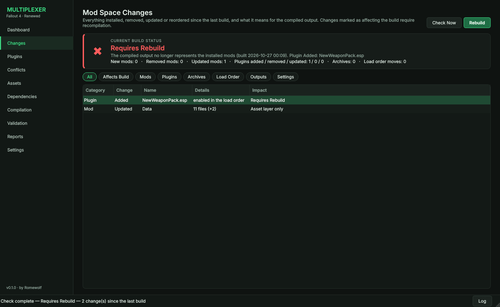
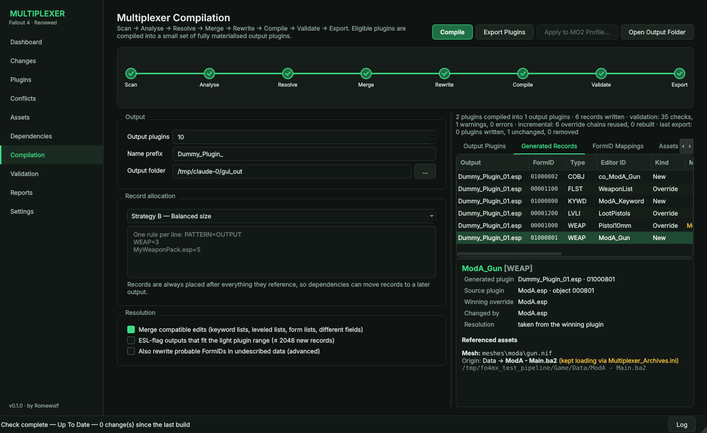
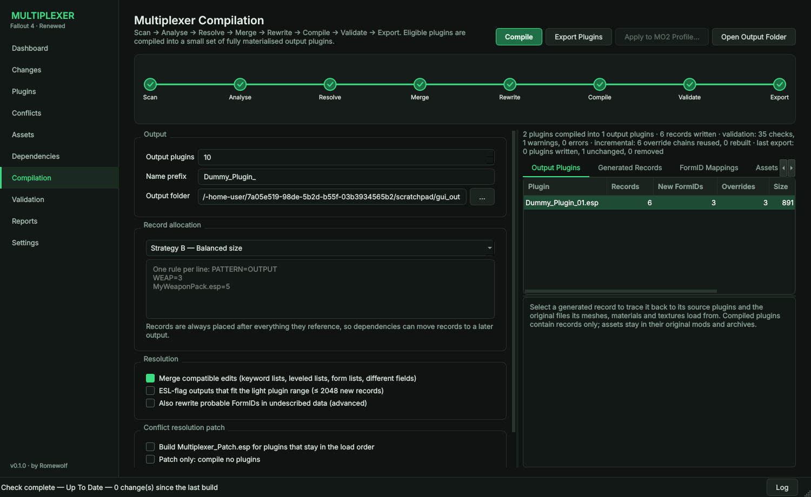
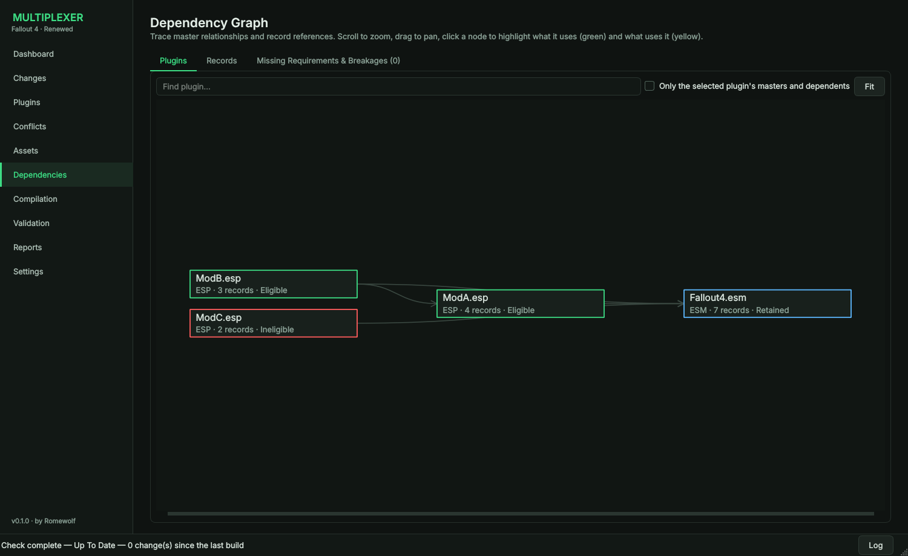

# Fallout 4 Multiplexer Renewed

**A Fallout 4 mod compilation, conflict resolution and load order intelligence platform.**

Author: Romewolf · Target runtime: **Fallout 4 1.10.163 (Old Gen)** · Windows 10/11 x64



Fallout 4 Multiplexer Renewed is a compiler for large modded installations. It reads every plugin, BA2 archive and loose file the game would load, works out the final winning state of every record and asset, merges compatible edits, and compiles the result into a small set of generated output plugins (`Dummy_Plugin_01.esp` …). The outputs contain real Bethesda records with real FormIDs and open in xEdit, FO4Edit and the Creation Kit like any other plugin.

The outputs are **record containers only**. No mesh, texture, material, script or sound is copied, extracted or repacked: compiled records keep their original asset paths, and Fallout 4 keeps loading every asset from the mod, loose file or BA2 archive that provides it today.

It behaves like a **build system**. It fingerprints your mod space, notices when mods are installed, removed, updated or reordered, tells you whether the compiled output is still up to date, and rebuilds only what changed.

It is **not** a mod manager, load order sorter, Bash Patch replacement or runtime virtualisation layer.

## What it does

| Area | Capabilities |
|---|---|
| **Plugin analysis** | Every installed plugin with type (ESM/ESP/ESL/ESL-flagged), load order index, record counts (new / override / injected / ITM / deleted), masters and dependents, and compilation eligibility with the reason. Plugin count is limited only by memory. |
| **Conflict Centre** | Override chain of every record; the winning plugin and *why*; field-by-field comparison coloured green (winning), red (replaced), yellow (merged); the compiled result; conflict types 1 (simple override), 2 (compatible merge), 3 (hard conflict); per-record user resolution; sort by any column; filter by the plugin that is involved, wins or loses; where each record is written. |
| **Asset intelligence** | Loose files and BA2 archives (general and texture) merged in engine order (INI archive lists, then plugin archives, then loose files by mod priority); winning source and reason; every alternative version; texture preview (BC1–BC5, uncompressed), mesh structure (NIF blocks and materials), material texture slots. |
| **Dependency analysis** | Zoomable plugin master graph and record reference graph with search and relationship highlighting; missing masters; references to records that do not exist. |
| **Compilation** | Resolve → Merge → Rewrite → Compile → Validate → Export. Field-level merging (keyword, form and leveled lists merge additions and removals), three allocation strategies, FormID translation with reference rewriting (including script properties, conditions, object templates and OMOD data), stable FormIDs across recompiles. |
| **Conflict resolution patch** | Optional `Multiplexer_Patch.esp`, similar to a Bashed Patch: merges leveled lists, form lists, keyword lists and separate field edits between plugins that stay in the load order. Override-only, so it is always ESL-flagged and changes no FormIDs. Can be built on its own without compiling anything. |
| **Asset traceability** | For every generated record: generated plugin, source plugin, winning override, and every mesh, material and texture it uses with the mod, archive and file path that serves it. Missing assets are reported. Nothing is duplicated. |
| **Change detection** | Snapshots of mods, plugins (content hashes), archives, loose files, load order and dates. On startup the dashboard shows **✓ Up To Date**, **⚠ Changes Detected** (assets only) or **✖ Requires Rebuild**, with exactly what changed and which record types are affected. |
| **Incremental rebuilds** | Unchanged plugins are not re-parsed, unchanged override chains are not re-analysed or re-merged, and output plugins whose content did not change are not rewritten. |
| **Validation** | Missing references, broken FormIDs, duplicate IDs, missing masters, circular dependencies, orphaned records, undecodable data, a self-check of the record definitions against your real data, and a read-back of every written file. Critical failures block export. |
| **Reports** | Conflict, asset, dependency, compilation and validation reports as HTML, JSON and PDF. |
| **Mod managers** | Mod Organizer 2 (instance, profile, modlist priority, overwrite, profile-local INIs, the virtual Data folder), Vortex (deployment manifest for attribution), standalone installs. |

| Conflict Centre | Asset Intelligence |
|---|---|
|  |  |
| **Mod Space Changes** | **Asset Traceability** |
|  |  |
| **Compilation** | **Dependency Graph** |
|  |  |

## Workflow


1. Install mods normally (MO2, Vortex or manually).
2. Launch Fallout 4 Multiplexer Renewed. The **Setup** screen asks how your mods are installed, where the game, MO2 instance and output folder are, and which `plugins.txt` to use. It checks each folder and previews the load order before the main window opens.
3. **Scan**: plugins, records, archives and loose files.
4. **Analyse**: conflicts, dependencies and compilation eligibility.
5. Review the **Plugins**, **Conflicts**, **Assets** and **Dependencies** pages; force winners where you disagree.
6. **Compile**: merges, allocates and rewrites in memory, then validates.
7. **Export**: writes the output plugins plus `Multiplexer_FormMap.tsv`, `Multiplexer_Archives.ini`, `Multiplexer_DisablePlugins.txt` and a proposed `plugins.txt`.
8. Enable the outputs, disable the compiled plugins (or use **Apply to MO2 Profile**, which backs up your files first), and merge the archive INI so compiled plugins' BA2s keep loading from where they are.
9. Play with the compiled output.
10. Later, install, update or remove mods as usual. The app shows what changed since the build. **Rebuild** reuses everything that did not change.

## Assets stay where they are

Compilation touches the record layer only:

```
WeaponExpansion.esp ─┐                          Dummy_Plugin_04.esp
MyBalancePatch.esp ──┼─► compiled WEAP / OMOD ─► (records only)
                     │   records keep their            │
                     │   original asset paths          ▼ at runtime
WeaponExpansion - Main.ba2 ─────────────────────► meshes\weapons\10mm\10mm.nif
WeaponExpansion - Textures.ba2 ─────────────────► textures\weapons\10mm\10mm_d.dds
```

The only runtime effect of disabling a compiled plugin is that Fallout 4 stops auto-loading the archives named after it (`WeaponExpansion - Main.ba2`). `Multiplexer_Archives.ini` registers those same archives, in their original location, so the assets keep loading. No copies are made. Each generated record's traceability view shows which assets depend on this registration.

## Build status and incremental rebuilds

| Status | Meaning |
|---|---|
| ✓ **Up To Date** | The compiled output matches the installed mods. |
| ⚠ **Changes Detected** | Only the asset layer changed (loose files, archives of plugins that were not compiled). The compiled records are still valid. |
| ✖ **Requires Rebuild** | A plugin was added, removed, updated, enabled, disabled or moved; an archive of a compiled plugin was added or removed; compilation settings changed; or a generated plugin was deleted or edited by hand. |

Plugins are fingerprinted by content hash, so re-saving or touching a file without changing it is not reported. Loose files are fingerprinted per mod by path, size and modification date. A rebuild reuses the build cache (`multiplexer.cache.sqlite`, next to the results database): unchanged plugins are not re-parsed, unchanged override chains are not re-analysed or re-merged, and output plugins with identical content are left untouched on disk. FormIDs stay stable through `Multiplexer_FormMap.tsv`.

See the [User Guide](docs/USER_GUIDE.md) for details.

## What can be compiled

A plugin is compiled only when the compiled output can reproduce it exactly. In this release that means:

- all of its records are supported types:
  - **Phase One:** `WEAP ARMO AMMO OMOD COBJ KYWD LVLI FLST INGR ALCH MISC BOOK NOTE KEYM FACT PERK SPEL MESG`;
  - **Tier 1:** `ARMA OTFT LVLN CONT CMPO GLOB TXST MSWP INNR ENCH MGEF IPDS AORU STAT SCOL MSTT ACTI FURN DOOR LIGH TERM PROJ EXPL IPCT HAZD SNDR SOUN AVIF EQUP LSCR DMGT ZOOM AMDL ARTO EFSH MATO FLOR KSSM LCRT RFCT TRNS DFOB CLFM`;
- no script or F4SE/MCM config refers to it by file name (`GetFormFromFile` etc.);
- no FaceGen or voice folders are named after it;
- it is not a master of a plugin that stays in the load order;
- it is not the base game, DLC, Creation Club content, or on your exclusion list.

Every other plugin stays in the load order untouched, and the Plugins page tells you why. **Plugins → Blocking Types** ranks the unsupported record types in *your* load order by how many plugins supporting each one would make compilable. Mods that edit cells, NPCs, quests or dialogue are analysed fully but compiled in a later phase (`NPC_ QUST WRLD CELL REFR ACHR DIAL INFO`). [Dependency and Compilation Scenarios](docs/DEPENDENCY_SCENARIOS.md) explains the tiers.

**Validation → Check Record Definitions** (or `fo4mx check-definitions`) decodes every record of the supported types in your load order, base game included, and reports any field layout that looks wrong. Run it once after installing a new version.

## Important caveats

- **Not yet tested against real game data.** The engine is covered by an automated test suite that builds synthetic installs (base master, mods, string tables, BA2s, an MO2 instance) and verifies every rewritten reference in the compiled plugins. It has not yet been run on a real Fallout 4 load order. The Phase One field layouts were written from community documentation; the validation engine measures how many decoded FormIDs resolve in your actual load order and flags any layout that looks wrong. **Run your first compilations on a test profile and inspect the output in FO4Edit.**
- **New games recommended.** Records from compiled plugins receive new FormIDs, so existing saves that reference them will not find them. Recompiling reuses the previous FormIDs (from `Multiplexer_FormMap.tsv`) wherever dependencies allow, and warns when one has to change.
- **Archives.** BA2s named after a compiled plugin (`MyMod - Main.ba2`) no longer load automatically once the plugin is disabled. Merge the generated `Multiplexer_Archives.ini` into `Fallout4Custom.ini`.
- **Load order slots.** Outputs are full ESPs unless *ESL-flag outputs* is on and they fit the light range.
- **Previews.** BC6H/BC7 textures show metadata only; meshes show structure (blocks, materials), not a 3D view.
- **Windows.** CI builds, tests and packages the Windows version (MSVC, Qt 6) on every push. The download is the workflow artifact. The desktop app has not yet been used against a real Windows Fallout 4 installation.
- **Mesh tracing.** Textures are traced through the materials (`.bgsm`/`.bgem`) a mesh names. Texture sets embedded directly in mesh blocks are not followed yet.

## Building

Requirements: CMake ≥ 3.21, a C++20 compiler, Qt 6 (Widgets, Sql), SQLite3, zlib, spdlog.

**Windows (MSVC + vcpkg):**

```powershell
# Qt 6 from the Qt installer; zlib, sqlite3 and spdlog come from vcpkg.json
$env:VCPKG_ROOT = "C:\vcpkg"
$env:CMAKE_PREFIX_PATH = "C:\Qt\6.7.3\msvc2019_64"
cmake --preset windows-msvc
cmake --build --preset windows-msvc
ctest --preset windows-msvc
```

**Linux (development and tests):**

```bash
sudo apt install qt6-base-dev libqt6sql6-sqlite libspdlog-dev libsqlite3-dev zlib1g-dev ninja-build
cmake --preset linux-dev && cmake --build --preset linux-dev && ctest --preset linux-dev
```

Options: `-DFO4MX_BUILD_GUI=OFF`, `-DFO4MX_BUILD_CLI=OFF`, `-DFO4MX_BUILD_TESTS=OFF`.

## Command line

The `fo4mx` tool runs the same pipeline without the GUI:

```text
fo4mx status   --mo2 "C:\Modding\MO2"          # what changed since the last build?
fo4mx scan     --mo2 "C:\Modding\MO2" [--profile Default]
fo4mx analyse  --mo2 "C:\Modding\MO2" --reports .\Reports
fo4mx compile  --mo2 "C:\Modding\MO2" --outputs 16 --strategy type --dry-run
fo4mx compile  --game "D:\Games\Fallout 4" --plugins plugins.txt --exclude "MyPatch.esp" --out .\Output
fo4mx info     MyMod.esp
fo4mx dump     Dummy_Plugin_01.esp --formid 0100080A
fo4mx ba2      "MyMod - Main.ba2" --extract textures\foo.dds --to foo.dds
```

Run `fo4mx help` for every option.

## Project layout

```
src/core/      C++20 library: formats, install/VFS, engines, database, reports
  esp/         records, groups, compression, TES4, string tables, field definitions, FormID decoder
  ba2/         BA2 reader (GNRL/DX10)
  vfs/         MO2 / Vortex / standalone install resolution, virtual Data folder
  assets/      asset index, asset scanner, texture/mesh/material preview
  engine/      session, scanner, conflict, dependency, merge, compilation, validation, export, pipeline
  db/          SQLite schema and writer
  report/      HTML / JSON report generator
src/cli/       fo4mx command line tool
src/gui/       Qt 6 desktop application
tests/         self-contained test suite (synthetic installs, end-to-end compilation)
docs/          specification, architecture, user guide, screenshots
```

## Documentation

- [Vision, Architecture & Product Specification](docs/VISION_SPECIFICATION.md)
- [Architecture](docs/ARCHITECTURE.md): how the compiler works and why
- [Dependency and Compilation Scenarios](docs/DEPENDENCY_SCENARIOS.md): what happens when compiled and retained plugins depend on each other
- [User Guide](docs/USER_GUIDE.md)

## Related

- [Fallout 4 Transition Layer](https://github.com/LordRichardCL/Fallout_4_Transition_Layer)
