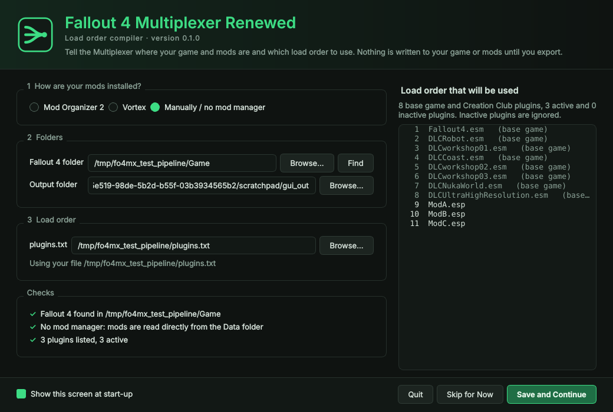
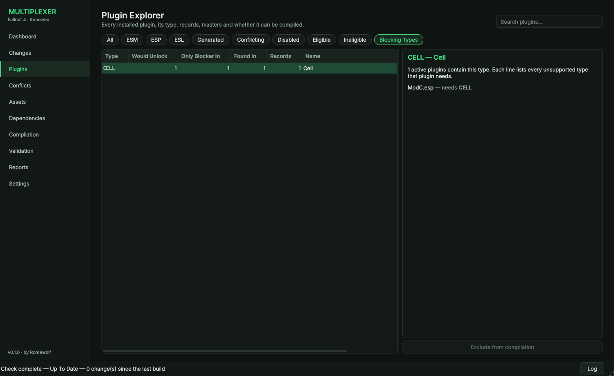
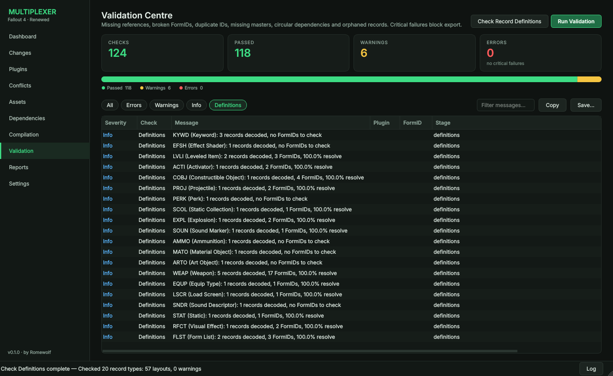

# User Guide

## Before you start

- Use a **test profile** for your first compilations (in MO2, copy your profile). Compilation writes new files and only changes your load order when you ask it to.
- Work on a **new game** or a save you can afford to lose. Compiled records get new FormIDs.
- Fallout 4 **1.10.163** (Old Gen) is the supported runtime.

## 1. Setup



The **Setup** screen opens when the app starts.

1. **How are your mods installed?** Mod Organizer 2, Vortex, or manually.
2. **Folders.** The Fallout 4 folder (**Find** reads it from the registry), the MO2 instance (**Find** looks in `%LOCALAPPDATA%\ModOrganizer`) and profile, and the output folder for the generated plugins. Leave the output folder empty to choose it automatically.
3. **Load order.** Leave `plugins.txt` empty to use the one your mod manager uses, or select another file.

The **Checks** list confirms that the game, the mod manager and the load order were found. The right-hand side shows the exact load order that will be used, with inactive plugins greyed out. **Save and Continue** is available once every check passes. **Skip for Now** opens the app without saving.

Untick **Show this screen at start-up** to go straight to the Dashboard next time. The screen still appears if the saved folders stop working, for example after moving the game. **Settings → Open Setup Screen** opens it at any time.

## 2. Settings

**Settings** holds the same installation details plus everything else. Choose your installation type:

| Type | What to enter |
|---|---|
| Mod Organizer 2 | The MO2 instance folder (the one containing `ModOrganizer.ini`; for global instances it is under `%LOCALAPPDATA%\ModOrganizer\<name>`). Pick a profile or leave "selected in MO2". The game folder is read from MO2. |
| Vortex | The Fallout 4 folder. Vortex deploys into `Data`, and its `vortex.deployment.json` is used to attribute files to mods. |
| Standalone | The Fallout 4 folder. `plugins.txt` is read from `%LOCALAPPDATA%\Fallout4`. |

Optional overrides: a different `plugins.txt`, a different INI folder, and the string table language (for localised plugins).

**Never compile these plugins** lets you keep plugins in the load order. For example, keep a patch you are still editing.

## 3. Scan

**Dashboard → Scan** builds the virtual Data folder and reads every plugin, archive and loose file. The dashboard then shows mods, plugins (ESM/ESP/ESL), archives, loose files, records and eligibility.

## 4. Analyse

**Analyse** walks every override chain and classifies conflicts, builds the record reference graph and evaluates compilation eligibility.

### Plugins

Filter by ESM/ESP/ESL, conflicting, disabled, eligible, ineligible, or **Generated** (the compiled outputs).

**Blocking Types** lists every record type the compiler does not support yet that appears in your load order:

- **Would Unlock:** plugins that become compilable if only this type were supported. This includes plugins currently kept because something depends on them.
- **Only Blocker In:** plugins where it is the only unsupported type.
- **Found In:** how many active plugins contain the type, and how many records.

Select a type to see each plugin it blocks and everything else that plugin needs.

**Export…** (top right) saves a text file with every blocking type and the plugins it holds back, and every plugin's load order position, type, header flags, eligibility and reason, record types with counts, mod, masters and author. It is useful for planning which record types to support next.


 The detail panel shows masters, dependents, record types, archives and the **exact reason** a plugin can or cannot be compiled. Use **Exclude from compilation** to keep a plugin.

### Conflicts

- **Hard Conflicts** (type 3): two plugins changed the same field differently. Someone loses.
- **Compatible Merges** (type 2): plugins changed different things. Last-plugin-wins would lose edits; compilation merges them.
- **Simple Overrides** (type 1): nothing is lost.
- **Critical**: the winner deletes a record.

Finding conflicts:

- **Click any column header** to sort by it (Winning Plugin, Editor ID, Severity, Written To, …). Click again to reverse.
- **Plugin** + **is involved / wins / loses** shows only the conflicts of one plugin. For example, "MyPatch.esp loses" lists every record where your patch is overridden. The list shows how many conflicts each plugin takes part in and how many it wins.
- **Double-click** a row to filter by its winning plugin.
- **Written To** shows which generated plugin (a `Dummy_Plugin_XX.esp` or `Multiplexer_Patch.esp`) carries the resolved record after compiling. It is empty when last-plugin-wins still applies.
- **Clear Filters** resets the type, search, plugin and sort.

Select a record to see the override chain and a grid of every field per plugin:

- green: the value that wins
- red: a value that is replaced
- yellow: a value merged in from a plugin that is not last
- blue column: what the compiler will write

**Winner when compiling** lets you force one plugin's version of the record. The choice is stored in the database and survives rescans.

### Assets

**Conflicting** lists every path provided by more than one source. Select an asset to see the winning mod, the reason (loose beats archive; later archives beat earlier ones; higher mod priority wins) and every alternative. Select an alternative to preview it. Textures show resolution, format, mip levels and an image (BC1–BC5 and uncompressed formats). Meshes show their block structure and referenced materials. Materials show their texture slots.

### Dependencies

- **Plugins**: the master graph, coloured by eligibility. Double-click a plugin to show only its masters and dependents.
- **Records**: search an Editor ID or FormID to see what a record references (green) and what references it (yellow). Double-click to re-centre.
- **Missing Requirements & Breakages**: missing masters and references to records that do not exist.

## 5. Compile

Open **Compilation**:

- **Output plugins**: 10–20. Unused slots are not written.
- **Name prefix**: `Dummy_Plugin_` by default.
- **Strategy**: A (by record type), B (balanced size), or C (user rules like `WEAP=3` or `MyWeapons.esp=5`). Records always come after everything they reference, so rules are preferences, not guarantees.
- **Merge compatible edits**: on by default. Turn it off for strict last-plugin-wins.
- **ESL-flag outputs**: saves load order slots when an output has ≤ 2048 new records.
- **Conflict resolution patch**: also writes `Multiplexer_Patch.esp`, similar to Wrye Bash's Bashed Patch. Plugins that stay in the load order still lose edits to last-plugin-wins: two mods adding to the same leveled list, form list or keyword list, or changing different fields of the same record. The patch carries the merged record instead, and respects winners you forced in the Conflict Centre.
  - It only overrides existing records, so it adds no FormIDs, is always ESL-flagged and takes no full load order slot.
  - It must load last. The proposed `plugins.txt` puts it there.
  - It covers the same record types as compilation. NPCs, quests and world data are not merged.
  - A patch can have at most 254 masters. Larger load orders get `Multiplexer_Patch_2.esp`, `_3`, and so on. Every one is ESL-flagged, so they take no full slots.
  - **Patch only** writes just the patch and compiles nothing, so no FormIDs change and no plugins are disabled.

Press **Compile**. Everything happens in memory and is then validated. The **Validation** page lists every finding. Errors block export.

## 6. Export and switch over

**Export Plugins** writes, to the output folder (by default an MO2 mod folder named `Fallout 4 Multiplexer Output`, otherwise `Data`):

| File | Purpose |
|---|---|
| `Dummy_Plugin_XX.esp` | the compiled game state |
| `Multiplexer_FormMap.tsv` | every old → new FormID; also lets the next compilation keep the same FormIDs |
| `Multiplexer_Archives.ini` | the compiled plugins' BA2s, for `Fallout4Custom.ini` (**Apply to Game** does this for you) |
| `Multiplexer_ArchivePriority.txt` | only when needed: files whose winning archive changes after switching (see below) |
| `Multiplexer_DisablePlugins.txt` | plugins that are now compiled |
| `Multiplexer_plugins.txt` | a proposed `plugins.txt` |
| `Multiplexer_Compilation.json` | machine-readable summary |
| `Multiplexer Reports/` | all reports (HTML + JSON) |

Then:

1. In MO2, enable the output mod (or refresh if you exported into an existing mod).
2. On the **Compilation** page, press **Apply to Game…**. It makes a timestamped backup of every file first, then:
   - **Mod Organizer 2, output folder inside the mods folder (the default):** compiled plugins that have archives are replaced by **archive loaders**. An archive loader is an empty, ESL-flagged plugin with the same file name, written into the output mod. It stays enabled in the same load order position, so the game loads that mod's archives at exactly the same priority as before, and it takes no full load order slot. The records themselves are in the Dummy plugins. Keep the output mod at the **bottom of the left pane** so it overrides the original plugins; validation warns if it does not.
   - **Mod Organizer 2:** rewrites the profile's `plugins.txt`/`loadorder.txt` so compiled plugins are disabled and the generated ones enabled.
   - **Other installs (or MO2 with an output folder outside the mods folder):** adds the compiled plugins' archives to `SResourceArchiveList2` in `Fallout4Custom.ini`, in the folder the game reads its INIs from (the MO2 profile when it uses profile-local INIs). Archives an earlier build added but this one no longer needs are taken out again. Every other line of the INI is kept as it was.
   - **Vortex and manual installs:** disable the plugins in `Multiplexer_DisablePlugins.txt` and enable the generated plugins yourself (Vortex manages `plugins.txt`).
3. **Keep the compiled mods installed.** In MO2, untick only their *plugins* (right pane), never the mods themselves (left pane). Their textures, meshes and archives must stay in the Data folder.
4. Open the outputs in FO4Edit and spot-check a few records.

### Archive priority

With archive loaders (MO2) nothing changes: every archive keeps its position. Without them, archives listed in the INI load before every plugin's own archives. Once compiled plugins' archives move into that list, an archive of a plugin that stays can start winning a file it used to lose. The **Validation** page lists these under **Archive Priority** (up to 50, with the full list in `Multiplexer_ArchivePriority.txt`). To keep the compiled mod's version of a file, exclude that mod from compilation, or provide the file loose (loose files beat every archive).

### When some records cannot be compiled safely

If validation finds records that cannot be written safely, for example a FormID in data the app does not fully understand, the app does **not** block the whole export. It keeps those records' plugins in the load order (or leaves those records out of the patch) and compiles again. The **Validation** page lists every plugin it kept out under **Kept Out Automatically**, with the reason. The **Plugins** page shows them as *Retained*. Only errors that cannot be traced to a plugin or record still block export.

## Checking the record definitions

The app needs the exact layout of every record type it compiles. This check confirms those layouts against **your** game files. Run it once after installing a new version of the app, and send the result to the developer if it shows warnings.

1. Start the app. On the **Setup** screen, check the folders and press **Save and Continue**.
2. In the left sidebar, click **Validation**.
3. At the top right, click **Check Record Definitions**.
   - The status bar at the bottom shows progress. A large load order takes a few minutes.
   - You do not need to Scan, Analyse or Compile first. The check scans by itself if needed.
4. When the status bar says **Check Definitions complete**, click the **Definitions** filter above the table.
5. Read the rows:
   - **Info:** one line per record type, for example "ARMA (Armor Addon): 2,310 records decoded, 9,120 FormIDs, 99.9% resolve". Close to 100% is good.
   - **Warning:** a layout that looks wrong (few FormIDs resolve, unexpected sizes) or a field the app does not describe yet. Records are still protected: a wrong layout can block an export, but it cannot produce a broken plugin.
6. Click **Save…** to write the rows shown to a text file (default `DefinitionCheck.txt` in Documents), or **Copy** to put them on the clipboard.



The same **Copy** and **Save…** buttons work for any filter. For example, after a compile, click **Errors** and then **Save…** to send the errors that blocked an export.

Command line: `fo4mx check-definitions --mo2 "C:\Modding\MO2"` prints the same results (exit code 4 if there are warnings).

## Rebuilding after switching over

You do not need to switch back to the original load order to rebuild. Scans recognise the app's own files: Dummy plugins and patches are never read as sources, an archive loader is looked through to the original plugin underneath it, and plugins the last build compiled count as active sources in their original position even though they are disabled now. **Changes** and **Rebuild** therefore work straight from the switched-over load order.

## Starting fresh

**Settings → Reset to Fresh State…** removes everything the app has stored: settings and folders, exclusions, conflict resolutions, the results database, the build cache and the logs. The Setup screen then opens as on a first start. Your mods, your load order and the generated plugins in the output folder are not touched.

When you start a **new build** of the app for the first time, it clears the previous build's results and cache automatically (your settings and conflict resolutions are kept), so nothing stale carries over.

## Keeping the build up to date

When the app starts it compares your mod space with the last exported build. The Dashboard banner shows:

- **✓ Up To Date**: nothing that matters changed.
- **⚠ Changes Detected**: only assets changed (new textures, an updated loose-file mod). The compiled plugins are still correct.
- **✖ Requires Rebuild**: plugins were added, removed, updated or reordered, compilation settings changed, or a generated plugin was deleted or edited.

**Changes** lists every added, removed and updated mod, plugin and archive, load order moves, and whether each one requires a rebuild. It also shows which record types the changed plugins contain and which compiled types are unaffected. **Check Now** re-runs the comparison at any time.

**Rebuild** runs Scan → Analyse → Compile → Export in one step and reuses everything that did not change:

- unchanged plugins are not re-parsed;
- unchanged override chains are not re-analysed or re-merged;
- output plugins whose content is identical are not rewritten;
- outputs the new build no longer needs are removed;
- records keep their FormIDs (`Multiplexer_FormMap.tsv`); a record that must move is reported as a *FormID Stability* warning.

Compile into the same output folder each time.

## Assets

Compilation never copies, extracts or repacks assets. Compiled records keep their original mesh, texture and material paths, and the game loads those files from the mods that provide them. The only thing to do is merge `Multiplexer_Archives.ini`, so archives that belonged to compiled plugins keep loading from where they are.

On the Compilation page, select a record under **Generated Records** to see its generated plugin, source plugin, winning override, and every mesh, material and texture it uses with the mod, archive and path each one is served from. **Assets Used** lists all of them. Missing assets are reported in the Validation Centre.

## Reports

**Reports** previews each report and exports it as HTML, JSON or PDF. **Export All** writes every report to a folder.

## Command line

Everything is also available through `fo4mx` (run `fo4mx help`), for example:

```text
fo4mx compile --mo2 "C:\Modding\MO2" --profile "Test" --outputs 16 --strategy type --dry-run
```

`--dry-run` stops after validation. `fo4mx status …` prints the build status and every change since the last build (exit code 3 when a rebuild is required, handy for scripts). `--no-cache` forces a full rebuild.

## Troubleshooting

| Symptom | What to do |
|---|---|
| A mod you expected to compile is ineligible | The Plugins page shows the reason, and **Blocking Types** shows which unsupported types hold back the most plugins. Most mods that touch cells, NPCs or quests are not compilable in this phase. |
| You want to be sure the record layouts match your game | **Validation → Check Record Definitions** decodes every supported record in your load order and lists any layout that looks wrong under **Definitions**. Findings never block export, and compiled records are always protected by validation. |
| Validation: "probably refers to compiled record … in a layout this profile does not describe" | A record contains a FormID the definitions do not cover. Exclude the plugin it comes from, or enable *rewrite probable FormIDs* if you have checked the field in FO4Edit. |
| Validation: "Only N% of FormIDs in X Y resolve" | The field layout for this runtime looks wrong. Please report it with the plugin name. |
| Missing textures in game after switching | Merge `Multiplexer_Archives.ini` into `Fallout4Custom.ini`. |
| A localised mod shows empty names | Its `Strings\<plugin>_<lang>.STRINGS` files were not found. Set the right language in Settings. |

Logs are written to `%LOCALAPPDATA%\Fallout4MultiplexerRenewed\logs`. The **Log** button in the status bar shows them live.
