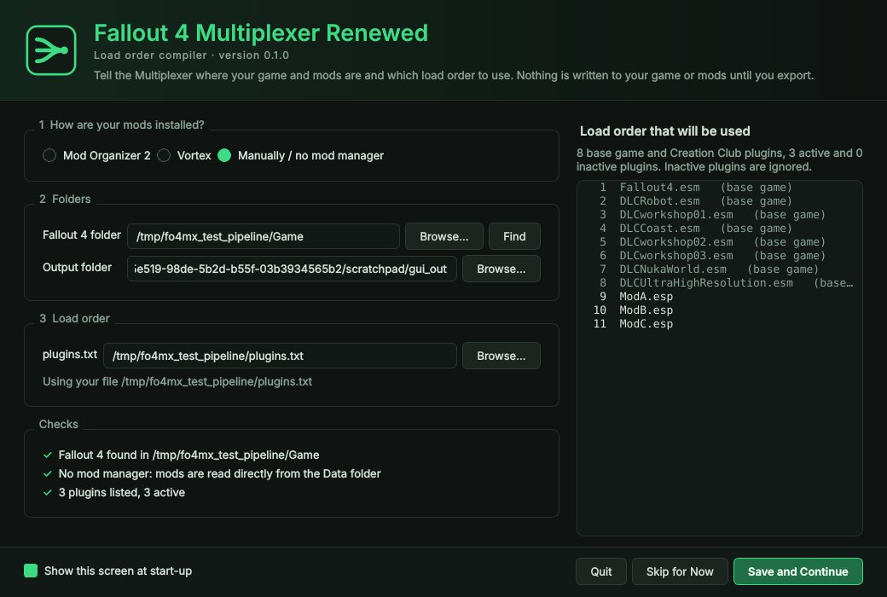
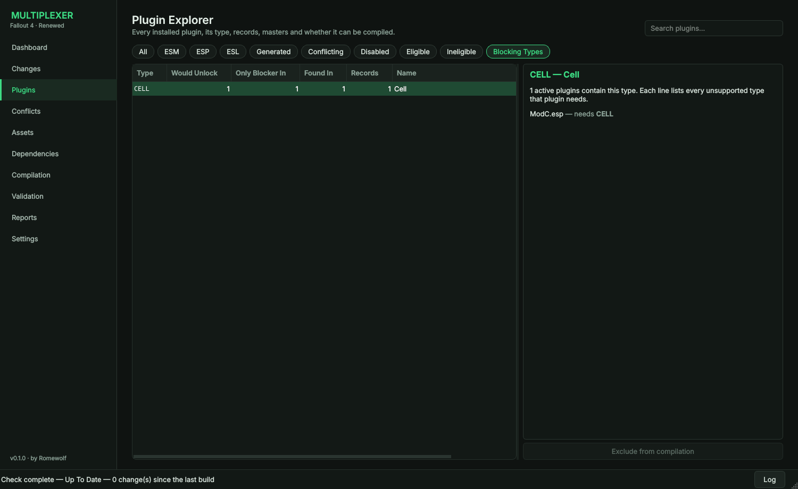
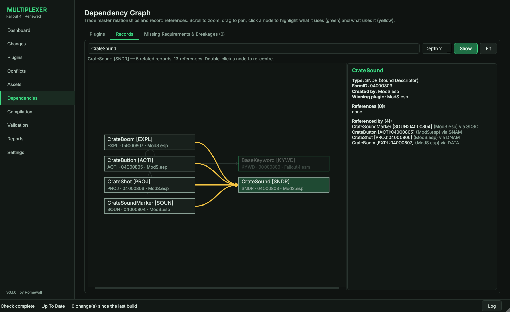
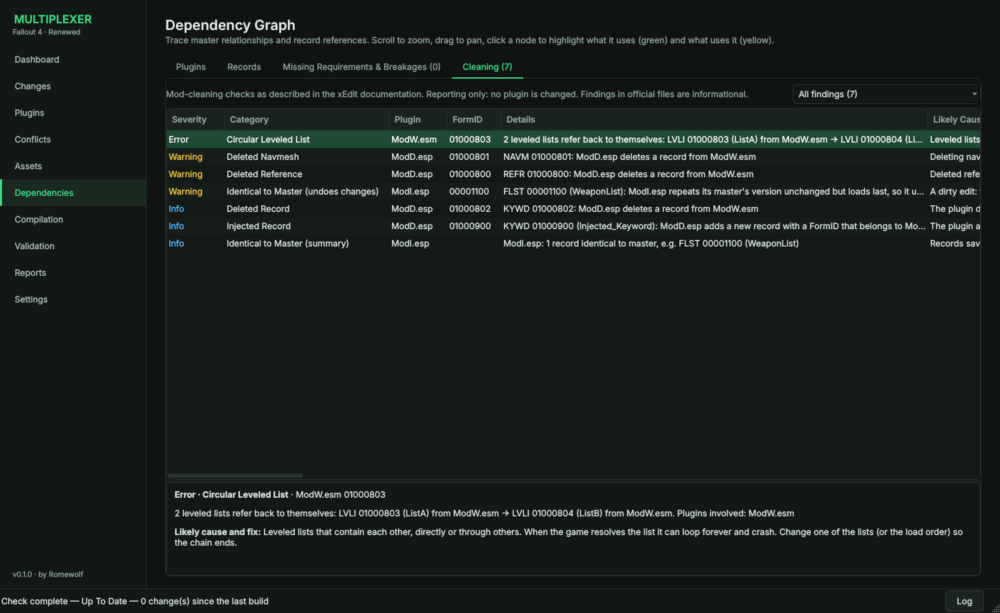
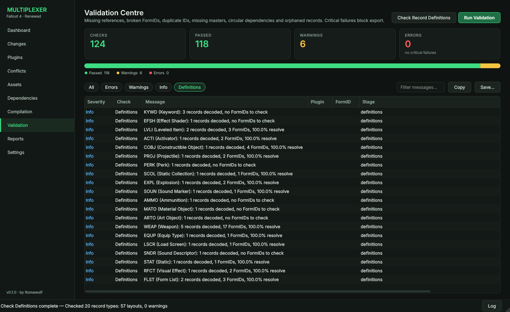

# User Guide

## Before you start

- Use a **test profile** for your first compilations (in MO2, copy your profile). Compilation writes new files and only changes your load order when you ask it to.
- Work on a **new game** or a save you can afford to lose. Compiled records get new FormIDs.
- Fallout 4 **1.10.163** (Old Gen) is the supported runtime.

## 1. Setup



The **Setup** screen opens when the app starts.

1. **How are your mods installed?** Mod Organizer 2, Vortex, or manually.
2. **Folders.** The Fallout 4 folder (**Find** reads it from the registry), the MO2 instance (**Find** looks in `%LOCALAPPDATA%\ModOrganizer`) and profile, and the output folder for the generated plugins. Leave the output folder empty to choose it automatically.
3. **Load order.** Leave `plugins.txt` empty to use the one your mod manager uses, or select another file.

The **Checks** list confirms that the game, the mod manager and the load order were found. The right-hand side shows the exact load order that will be used, with inactive plugins greyed out. **Save and Continue** is available once every check passes. **Skip for Now** opens the app without saving.

Untick **Show this screen at start-up** to go straight to the Dashboard next time. The screen still appears if the saved folders stop working, for example after moving the game. **Settings → Open Setup Screen** opens it at any time.

## 2. Settings

**Settings** holds the same installation details plus everything else. Choose your installation type:

| Type | What to enter |
|---|---|
| Mod Organizer 2 | The MO2 instance folder (the one containing `ModOrganizer.ini`; for global instances it is under `%LOCALAPPDATA%\ModOrganizer\<name>`). Pick a profile or leave "selected in MO2". The game folder is read from MO2. |
| Vortex | The Fallout 4 folder. Vortex deploys into `Data`, and its `vortex.deployment.json` is used to attribute files to mods. |
| Standalone | The Fallout 4 folder. `plugins.txt` is read from `%LOCALAPPDATA%\Fallout4`. |

Optional overrides: a different `plugins.txt`, a different INI folder, and the string table language (for localised plugins).

**Never compile these plugins** lets you keep plugins in the load order. For example, keep a patch you are still editing.

## 3. Scan

**Dashboard → Scan** builds the virtual Data folder and reads every plugin, archive and loose file. The dashboard then shows mods, plugins (ESM/ESP/ESL), archives, loose files, records and eligibility.

## 4. Analyse

**Analyse** walks every override chain and classifies conflicts, builds the record reference graph and evaluates compilation eligibility.

### Plugins

Filter by ESM/ESP/ESL, conflicting, disabled, eligible, ineligible, or **Generated** (the compiled outputs).

**The summary above the table** counts every analysed plugin: **Total**, **Eligible** (will be compiled) and **Ineligible** (everything that will not be: plugins holding something the compiler cannot reproduce, retained ones such as the base game, Creation Club or your exclusions, inactive ones and unreadable ones; the card says how many of each). Eligible + Ineligible is always the total. Each is broken down by file type: ESL, ESL-flagged ESP, ESP and ESM (an ESM with the ESL flag counts as an ESM; its tooltip says how many). Click a card to filter the table to it; the **Ineligible** chip shows the same plugins as the card.

**Blocking Types** lists every record type the compiler does not support yet that appears in your load order:

- **Would Unlock:** plugins that become compilable if only this type were supported. This includes plugins currently kept because something depends on them.
- **Only Blocker In:** plugins where it is the only unsupported type.
- **Found In:** how many active plugins contain the type, and how many records.
- **Category** and **Support:** the type's group (Items, World, Quests and Dialogue, …) and how the compiler treats it: *Compiled*, *Preserved* (stays in its plugin, with the reason), or *Unknown record type*. An unknown type is not part of Fallout 4: the plugin may be for another game, or damaged. The plugin's reason says so too.

Select a type to see each plugin it blocks and everything else that plugin needs.

**Export…** (top right) saves a text file with every blocking type and the plugins it holds back, and every plugin's load order position, type, header flags, eligibility and reason, record types with counts, mod, masters and author. It is useful for planning which record types to support next.


 The detail panel shows masters, dependents, record types, archives and the **exact reason** a plugin can or cannot be compiled. Use **Exclude from compilation** to keep a plugin.

### Conflicts

- **Hard Conflicts** (type 3): two plugins changed the same field differently. Someone loses.
- **Compatible Merges** (type 2): plugins changed different things. Last-plugin-wins would lose edits; compilation merges them.
- **Simple Overrides** (type 1): nothing is lost.
- **Not Merged**: record types the app does not describe field by field (cells, NPCs, quests, game settings, …; see **Plugins → Blocking Types**). They are never merged: the winning plugin's version is used as it is, and the **Handling** column says *Not merged*. They are compared record by record:
  - **Conflict (Not Merged)**: two plugins changed the record independently, so the winner drops the other's change. The summary names whose changes are dropped. Change the load order or make a patch in xEdit.
  - **Simple Override**: one plugin changed it, or each later plugin was made with the earlier one as a master and builds on its version.
  - **Winner only**: types that are compiled but not merged field by field (strategy *Winner*). Their conflicts are classified the same way, and compiling writes the winning plugin's version whole, references rewritten. Choosing another plugin under **Winner when compiling** is not available for them.
  - The field table, when shown, is a generic comparison for information only. Its last column is **Used in Game** (the winner's version), not a compiled result, and **Winner when compiling** is disabled.
- **Critical**: the winner deletes a record.

Every override is compared with the version it was made against (the last earlier version in its own masters, as xEdit does), not with the original record.

Finding conflicts:

- **Not Merged** shows only the conflicts in record types the app keeps as they are.
- **Click any column header** to sort by it (Winning Plugin, Editor ID, Severity, Written To, …). Click again to reverse.
- **Plugin** + **is involved / wins / loses** shows only the conflicts of one plugin. For example, "MyPatch.esp loses" lists every record where your patch is overridden. The list shows how many conflicts each plugin takes part in and how many it wins.
- **Double-click** a row to filter by its winning plugin.
- **Written To** shows which generated plugin (a `Dummy_Plugin_XX.esp` or `Multiplexer_Patch.esp`) carries the resolved record after compiling. It is empty when last-plugin-wins still applies.
- **Clear Filters** resets the type, search, plugin and sort.

Select a record to see the override chain and a grid of every field per plugin:

- green: the value that wins
- red: a value that is replaced
- yellow: a value merged in from a plugin that is not last
- blue column: what the compiler will write

**Winner when compiling** lets you force one plugin's version of the record. The choice is stored in the database and survives rescans.

### Assets

**Conflicting** lists every path provided by more than one source. Select an asset to see the winning mod, the reason (loose beats archive; later archives beat earlier ones; higher mod priority wins) and every alternative. Select an alternative to preview it. Textures show resolution, format, mip levels and an image (BC1–BC5 and uncompressed formats). Meshes show their block structure and referenced materials. Materials show their texture slots.

### Dependencies

- **Plugins**: the master graph, coloured by eligibility. Double-click a plugin to show only its masters and dependents.
- **Records**: search an Editor ID or FormID to see what a record references (green) and what references it (yellow). Double-click to re-centre.
- **Details panel** (right of both graphs): click a plugin or record to see it in full, since the boxes in the graph shorten long names. For a record that means its type, FormID, the plugin that created it and the one that wins, and every reference in both directions with the field that holds it. The panel scrolls.


- **Missing Requirements & Breakages**: missing masters and references to records that do not exist. These are problems in the mods themselves, typically a patch made for a different version of the mod it patches, or a record a mod removed in an update. The game reads such a reference as "none". Compiling keeps that behaviour: the reference is written as none and listed under **Broken in Source** on the Validation page, and the plugin is compiled normally.
- **Cleaning**: the mod-cleaning checks described in the xEdit documentation (chapter 7), for every plugin in your load order. **The app only reports these; it never changes a plugin.** Choose a category at the top right; select a row for the likely cause and the usual fix.
  - **Identical to Master (undoes changes)** (Warning): a record saved unchanged from the plugin's masters that loads after plugins that did change it, so their changes are lost. Clean the plugin's ITMs in xEdit, or load it earlier.
  - **Identical to Master (summary)** (Info): how many unchanged records each plugin has, with examples. Usually harmless.
  - **Deleted Reference** (Warning): a placed object or NPC deleted from a master. A significant cause of crashes; xEdit fixes it with *Undelete and Disable References*.
  - **Deleted Navmesh** (Warning): can crash the game and needs manual cleaning.
  - **Deleted Record** (Info): another record type deleted from a master.
  - **Injected Record** (Info): a new record in another plugin's FormID range. Sometimes deliberate.
  - **Circular Leveled List** (Error): leveled lists that contain each other, directly or through others. The game can loop forever when it resolves them.
  - Findings in the base game, DLC and Creation Club files are always **Info**: the xEdit documentation says not to correct errors in official files.

  Identical-to-master records are measured against the plugin's own masters' version, as xEdit does. For record types that are not merged, the comparison is byte by byte. With field comparison on (Settings), an override whose bytes differ only because of master order or compression is still recognised as identical. Otherwise such a record is not counted as identical.



## 5. Compile

Open **Compilation**:

- **Output plugins**: the most output plugins the compiler may create (1 to 64), or **Automatic**: the fewest output plugins whose master lists all fit (each plugin can have at most 254 masters), tried from 1 upwards; the number used is shown after Compile. Fewer outputs take fewer load order slots, each being larger.
  With a fixed number: It fills them in order and starts a new one only when the current one holds its share of the records (at least 2 MB), so a small load order uses fewer; unused ones are not written. Every output that is not ESL-flagged takes one of Fallout 4's **254 full plugin slots**, shared with the plugins that stay enabled; validation stops the export if the total passes 254 (and warns above 240). Outputs master each other, so the worldspace output has 254 minus this number of masters left for the plugins it needs. There is no benefit in more outputs than the load order needs: raise it when outputs grow very large (100 MB and more) or the worldspace output runs out of masters.
- **Name prefix**: `Dummy_Plugin_` by default (outputs are `<prefix>01.esp`, `<prefix>02.esp`, …).
- **Record allocation** decides how records are spread over the outputs; it does not change what the game sees. In every strategy a record goes into the same or a later output than the new records it references, cells, worldspaces and quests with dialogue go together into the last outputs, and a record keeps the output it had in the previous build when `Multiplexer_FormMap.tsv` is in the output folder (so saves keep working).

  | Strategy | What it does | Good for | Trade-off |
  |---|---|---|---|
  | **Balanced size** (default, recommended) | fills outputs one after another to about the same size, in dependency order | almost every load order | a record's output says nothing about its type |
  | **Grouped by record type** | gives each group of record types (the catalogue's allocation groups: items, actors, quests, world, …) its own outputs, sized by how much of it there is | browsing the result in xEdit | outputs reference each other more (more masters), uneven sizes |
  | **Balanced, with my rules** | balanced size, then rules such as `WEAP=3` (a record type) or `MyWeapons.esp=5` (the defining plugin, or a compiled plugin that changes the record) send records to that output | keeping a mod's records together in a known output | dependencies still win, so a rule is a preference, not a guarantee |

- **Merge compatible edits**: on by default. Turn it off for strict last-plugin-wins.
- **ESL-flag outputs**: an output with 2,048 or fewer new records is ESL-flagged and takes no full slot. Outputs with new cells or worldspaces never are.
- **Undescribed data is never guessed at.** Record data is read field by field from layouts taken from xEdit, so every reference to another record (FormID) is known and moved to its new FormID. Bytes the layouts do not describe (a subrecord the definitions do not list, data past a known layout, a condition function xEdit does not know) are kept exactly as written, never rewritten. They are moved only when they provably mean the same in the output: every 4 bytes at any position are zero, or name the same plugin at the same position in the source's and the output's master lists. Otherwise the record's plugin is kept out (**Kept Out Automatically**, category *Undescribed Data*, naming the plugin, the record, the subrecord, the byte range and the value). There is no option to rewrite values because they look like FormIDs (an earlier "advanced" option was removed).
- **Conflict resolution patch**: also writes `Multiplexer_Patch.esp`, similar to Wrye Bash's Bashed Patch. Plugins that stay in the load order still lose edits to last-plugin-wins: two mods adding to the same leveled list, form list or keyword list, or changing different fields of the same record. The patch carries the merged record instead, and respects winners you forced in the Conflict Centre.
  - It only overrides existing records, so it adds no FormIDs, is always ESL-flagged and takes no full load order slot.
  - It must load last. The proposed `plugins.txt` puts it there.
  - It covers the same record types as compilation. NPCs, quests and world data are not merged.
  - A patch can have at most 254 masters. Larger load orders get `Multiplexer_Patch_2.esp`, `_3`, and so on. Every one is ESL-flagged, so they take no full slots.
  - **Patch only** writes just the patch and compiles nothing, so no FormIDs change and no plugins are disabled.

Press **Compile**. Everything happens in memory and is then validated. The **Validation** page lists every finding. Errors block export.

## 6. Export and switch over

**Export Plugins** builds one installable mod, the same for every mod manager, in a folder of its own. Every export gets a new folder; an earlier export is never moved, renamed, deleted or changed:

```
<output folder>\                         Settings / Compilation page: "Output folder" (default <game folder>\Multiplexer Output)
├── Multiplexer Latest.txt               names the latest finished export
├── Multiplexer Output 081126 154512\    an earlier export, left exactly as it was
└── Multiplexer Output 081126 163020\    this export
    ├── Data\                            everything the game loads (see below)
    ├── Multiplexer Output.zip           the Data folder, zipped (Data\ at its root): install this
    ├── Multiplexer_DisablePlugins.txt, Multiplexer_plugins.txt, Multiplexer_Archives.ini, Multiplexer_Instructions.txt
    └── Multiplexer Reports\
```

- **While it is written** the folder is called `Multiplexer Output DDMMYY HHMMSS.tmp`; it gets its final name only when everything is written, and only then does `Multiplexer Latest.txt` name it. An export that fails or is interrupted stays `.tmp` (with `MULTIPLEXER_BUILD_FAILED.txt` saying why when it failed): it is never taken for a finished export, and the latest export stays the latest.
- **Two exports in the same second** get ` (2)`, ` (3)`, …; an existing folder is never reused.
- **You can keep an earlier export open** in File Explorer, xEdit, Mod Organizer 2 or the game while exporting again: nothing in it is touched.
- **The next build** reads its history (the FormID map that keeps FormIDs the same from build to build, the lists of copied files) from the latest finished export, or, before the first export of this version, from the single output folder earlier versions used.
- **Old exports** stay until you remove them: `fo4mx clean-outputs [install options] --keep 5` deletes all but the newest 5 (never the latest), with `--unfinished` also `.tmp` ones. Only Multiplexer's own export folders are touched (named like an export and holding its `Multiplexer_Run.txt`); one in use is skipped and left as it is. Your database, backups made by earlier versions and anything else in the output folder are never touched.
- **A folder inside Mod Organizer 2's mods folder** as the output folder makes every export a mod of its own in the mods folder (`Multiplexer Output DDMMYY HHMMSS`); Apply to Game enables the newest and switches the earlier export mods off (their folders stay).
- **The game's own `Data` folder** as the output folder writes the plugins there directly, as before (no export folders, no zip).
- Multiplexer's own results database and build cache, wherever they are, are never put in a zip.

Install `Multiplexer Output.zip` like any other mod, and make it win over every other mod (install it last):
- **Vortex:** let **Apply to Game** copy it to Vortex's downloads folder (see below), or drag the zip onto the Mods page; install and enable it, and let it win every file conflict (load after all other mods).
- **Mod Organizer 2:** *Install a new mod from an archive*, enable it, and keep it at the bottom of the left pane.
- **Manual:** extract the zip into the game folder (its Data folder merges with the game's).

The package is identical for every mod manager; only these instructions differ. (Advanced: an output folder set to a mod inside Mod Organizer 2's mods folder is used as the mod directly, without a zip; then compiled plugins that have archives get archive loaders instead of loose copies and INI entries. That is the only case where the generated files differ, because only there can the app check that the output mod overrides the original plugins.)

Files the game reads (they mirror the `Data` folder layout because the game finds them by path):

| Files | Why they are there | Needed |
|---|---|---|
| `<prefix>XX.esp`, `Multiplexer_Patch.esp` | the compiled game state and the conflict patch | always |
| `seq\<output>.seq` | start-game-enabled quests of each output; the game reads a plugin's SEQ file by its name | when an output has such quests |
| `sound\voice\<output>\…` | voice files of compiled new dialogue lines, renamed to the line's new FormID (the game finds voice by plugin name and FormID) | when compiled mods have voiced lines |
| `meshes\actors\character\facegendata\facegeom\<output>\…`, `textures\actors\character\facecustomization\<output>\…` | FaceGen of compiled new NPCs, renamed the same way | when compiled mods have NPCs with FaceGen |
| loose copies of meshes, textures and other files | without archive loaders, compiled plugins' archives load earlier (from the INI list); each file such an archive wins today is written loose so it keeps winning | Vortex / plain installs |
| copies of scripts and configs | the Advanced Users Auto-Merger's relinked copies, which must override the originals | when the Auto-Merger is on |
| archive loaders (same file name as the compiled plugin) | empty ESL-flagged plugins that keep a compiled mod's archives loading in place | MO2 with the output in the mods folder |

Files for you and for the next build (the game does not read them; nothing needs F4SE or any other runtime component). The build's records (`Multiplexer_FormMap.tsv` and the copy lists) are in `Data`, so they are installed with the package and the next scan finds them even if the `Multiplexer Output` folder was deleted; the notes (lists, INI line, reports) are next to `Data` and are not installed:

| File | Purpose |
|---|---|
| `Multiplexer_FormMap.tsv` | every old → new FormID; read by the next compilation to keep the same FormIDs (save compatibility) |
| `Multiplexer_Archives.ini` | a copy of the archive line **Apply to Game** writes into `Fallout4Custom.ini`; the game does not read this file itself |
| `Multiplexer_RegisteredArchives.txt` | archives Apply to Game added to the INI, so the next build compares with the load order as it was |
| `Multiplexer_ArchiveWinners.tsv`, `Multiplexer_Voices.tsv`, `Multiplexer_FaceGen.tsv`, `Multiplexer_Relinked.tsv` | what each copy above is and where it came from; the next export removes copies no longer needed, and the next scan does not mistake them for mod files |
| `Multiplexer_ArchivePriority.txt` | only when loose copies are off: files whose winning archive would change |
| `Multiplexer_ArchiveLoaders.txt` | MO2: which compiled plugins have an archive loader |
| `Multiplexer_DisablePlugins.txt`, `Multiplexer_plugins.txt` | plugins to disable, and a proposed `plugins.txt` (for Vortex and manual installs) |
| `Multiplexer Reports/` | all reports (HTML + JSON) |

Then:

1. Install and enable `Multiplexer Output.zip` as above (replace the previous version when you rebuild).
2. On the **Compilation** page, press **Apply to Game…**. It first shows what it will change and what it checked, and changes nothing until you confirm. It refuses (and explains why) when:
   - the build did not finish successfully;
   - more than 254 full plugins (or 4,096 light plugins) would be active after switching over: past 254, plugins take another plugin's load-order index, which crashes the game or loads the wrong records;
   - **manual install:** the output plugins are not in the game's `Data` folder yet, or differ from this build (install the zip first), because disabling the compiled plugins before their replacement is installed would remove their content from the game.
   It also warns when compiled plugins are still enabled: the game would then load their records twice. Every change is made together or not at all: each file is backed up first (`<file>.multiplexer-backup-<date>-<time>`, with `-2`, `-3`, … added rather than ever replacing an earlier backup), written whole through a temporary file, and if any step fails the files already changed are restored. Files whose content would not change are left alone. It then:
   - adds the compiled plugins' archives to `SResourceArchiveList2` in `Fallout4Custom.ini`, in the folder the game reads its INIs from (the MO2 profile when it uses profile-local INIs), so their textures and meshes keep loading. Archives an earlier build added but this one no longer needs are taken out again. Every other line of the INI is kept as it was.
   - **Mod Organizer 2:** also rewrites the profile's `plugins.txt`/`loadorder.txt` so compiled plugins are disabled and the generated ones enabled, keeping every other plugin's order and state. Only plugins are switched off: the mods stay enabled, because their meshes, textures, sounds and scripts are still used (the summary says which mods the compiled plugins come from). It works with MO2 **closed** (it writes the profile when it exits and would undo the change), and only once the game would see the outputs: in an enabled mod of the profile (checked in `modlist.txt` as it is now, the highest-priority copy deciding), in overwrite or in `Data`, identical to this build. Two ways to get there:
     - your output folder is a folder in MO2's mods folder: Apply to Game offers to enable that mod in the profile (a new entry goes to the top of the left pane, so it wins every conflict; a disabled one is switched on where it is; every other line is kept);
     - otherwise it offers to copy `Multiplexer Output.zip` into MO2's downloads folder (from `ModOrganizer.ini`; allowed while MO2 runs), to install from the Downloads tab.
     Ghosting is never used with MO2. Settings → *Find Instances* lists the global MO2 instances for Fallout 4 (in `%LOCALAPPDATA%\ModOrganizer`) and lets you pick one; a portable instance is the folder you installed MO2 in.
   - **Manual install:** also rewrites `plugins.txt` (and `loadorder.txt` when there is one) the same way.
   - **Vortex:** in two passes.
     1. With your Vortex downloads folder set (on the setup screen, *Mod downloads folder*, or Settings → Installation → *Vortex downloads folder*: Vortex's `downloads\fallout4` folder; *Use Vortex's Default* fills in `%APPDATA%\Vortex\downloads\fallout4` when it exists, *Check* tests it), Apply to Game offers to copy `Multiplexer Output.zip` there, so it appears on Vortex's Downloads page (restart Vortex if it does not). If an archive of that name is already there you choose **Replace** (the old one is backed up first), **Keep Both** (`Multiplexer Output (2).zip`) or **Cancel**. Without the setting, drag the zip onto Vortex's Mods page. Install and enable it in Vortex, let it win every file conflict, and Deploy.
     2. **Close Vortex** and press Apply to Game again. Once the outputs are deployed into `Data` and Vortex is not running, it rewrites `plugins.txt` (compiled plugins disabled, outputs enabled at the end) together with the INI. Vortex keeps its Plugins page in step with `plugins.txt` and reads it back when it starts; check that page afterwards. While Vortex is running, or before the outputs are deployed, the load order is not touched.
   - writes `Multiplexer_Instructions.txt` beside the package (also written at every export): the steps for your mod manager, the checks above, and how to undo everything.
   - **Optional (manual installs, and plugins Vortex did not deploy):** ghosts the compiled plugins (renames `Example.esp` to `Example.esp.ghost`) when you tick the box. Only a plugin this build compiled successfully, directly in the game's `Data` folder, unchanged since the scan, not needed as a master by any plugin that stays, and without an existing `.ghost` file is ghosted; the dialog lists every other plugin with the reason. `.ghost` names are never written into `plugins.txt` or `loadorder.txt`. Undo by renaming the file back. Ghosting is not offered under Mod Organizer 2 (it keeps disabled plugins off) and is never done to plugins Vortex deployed (Vortex would restore them).
   - **Ghosted plugins** (`Example.esp.ghost`, the name some tools give a plugin to hide it from the game) are recognised: the app reads them as `Example.esp`, not loaded by the game. A plugin the last build compiled stays a source of the next build when it is ghosted, as when it is disabled.
3. **Keep the compiled mods installed.** Disable only their *plugins*, never the mods themselves: their textures, meshes, archives, voice files and FaceGen are still used.
4. Open the outputs in FO4Edit and spot-check a few records.

### Archive priority

With archive loaders (MO2) nothing changes: every archive keeps its position. Without them, archives listed in the INI load before every plugin's own archives. Once compiled plugins' archives move into that list, an archive of a plugin that stays could start winning a file it used to lose. The app does not let that happen: each file a compiled plugin's archive wins today is written loose into the output folder (a loose file wins over every archive), so the same version still wins (`Multiplexer_ArchiveWinners.tsv`). A plugin that would need more than 2,000 such copies, such as a LOD pack, stays in the load order instead (**Kept Out Automatically**, "Archive priority: N files…"), and the compilation runs again without it. With Mod Organizer 2 and the output inside the mods folder, archive loaders keep every archive in place, so nothing is kept out for this reason. With loose copies turned off, any remaining change is listed under **Archive Priority** (up to 50, with the full list in `Multiplexer_ArchivePriority.txt`).

The comparison is always with your load order **as it was before this app changed the INI**: archives an earlier **Apply to Game** added count as their plugin's own. The app knows them from `Multiplexer_RegisteredArchives.txt` in the output folder, from the last build in its database, and from the oldest `Fallout4Custom.ini.multiplexer-backup-*` next to your INI (the INI before the first change). If you delete generated files between builds, keep those backups, or restore the oldest one first.

### When some records cannot be compiled safely

If validation finds records that cannot be written safely, for example a FormID in data the app does not fully understand, the app does **not** block the whole export. It keeps those records' plugins in the load order (or leaves those records out of the patch) and compiles again. The **Validation** page lists every plugin it kept out under **Kept Out Automatically**, with the reason. The **Plugins** page shows them as *Retained*. Only errors that cannot be traced to a plugin or record still block export.

## Checking the record definitions

Every **Analyse** also checks the **Candidate** record types (described but not compiled yet) against your load order, and the Validation Report (Definitions category) says for each whether your files confirm it. Send that report to the developer: confirmed types are switched on in the next version. The full check below also covers the compiled types and the group layout.

The app needs the exact layout of every record type it compiles. This check confirms those layouts against **your** game files. Run it once after installing a new version of the app, and send the result to the developer if it shows warnings.

1. Start the app. On the **Setup** screen, check the folders and press **Save and Continue**.
2. In the left sidebar, click **Validation**.
3. At the top right, click **Check Record Definitions**.
   - The status bar at the bottom shows progress. A large load order takes a few minutes.
   - You do not need to Scan, Analyse or Compile first. The check scans by itself if needed.
4. When the status bar says **Check Definitions complete**, click the **Definitions** filter above the table.
5. Read the rows:
   - **Info:** one line per record type, for example "ARMA (Armor Addon): 2,310 records decoded, 9,120 FormIDs, 99.9% resolve". Close to 100% is good.
   - **Warning:** a layout that looks wrong (few FormIDs resolve, unexpected sizes) or a field the app does not describe yet. Records are still protected: a wrong layout can block an export, but it cannot produce a broken plugin.
   - **Candidates:** record types whose layout is described (from xEdit's definitions) but which are **not compiled yet**. They are checked too: "LAYR (Layer): candidate confirmed by your load order" means your files match the layout exactly. "candidate not confirmed: …" names what did not match, and the type stays out. Send the result to the developer: confirmed candidates are then switched to compile in the next version.
   - **Group Layout:** the check also rebuilds every plugin in your load order that has cells, worldspaces, quests or dialogue topics with the app's nested group writer and reads it back. Empty groups (the Creation Kit leaves some) are left out and only counted. A plugin that is itself faulty (the same FormID twice) is reported as such and not counted against the writer. Every record must come back with the same content in the same cell, block and sub-block, and the file must have the same groups. Plugins over 64 MB (Fallout4.esm, the DLCs) are checked by placement only: every cell must be in the block the writer would choose. One Info line sums it up; each plugin with a difference gets a Warning. Nothing is compiled from cells yet: this confirms the writer against the Creation Kit's own files first.
6. Click **Save…** to write the rows shown to a text file (default `DefinitionCheck.txt` in Documents), or **Copy** to put them on the clipboard.



The same **Copy** and **Save…** buttons work for any filter. For example, after a compile, click **Errors** and then **Save…** to send the errors that blocked an export.

Command line: `fo4mx check-definitions --mo2 "C:\Modding\MO2"` prints the same results (exit code 4 if there are warnings).

`fo4mx record-types` lists every Fallout 4 record type the app knows: name, category, where it lives in a plugin, its strategy (*Specialised*: compiled with fields merged; *Winner*: compiled, the winning version taken whole; *Candidate*: described and checked, not compiled yet; *Preserve*: stays in its plugin) and support level. The list comes from `resources/record_catalogue.csv`, built from xEdit's Fallout 4 record list.

## Cells, worldspaces and placed references

Mods change the world by **editing existing objects** (moving a vanilla rock, disabling a car, changing a cell's lighting, tweaking landscape), by **placing new objects in existing cells** (a new workbench in Sanctuary, clutter in a vanilla interior), or by **adding new places** (a player home interior, a new worldspace). The compiler includes all three (stages W2, W3 and W4):

- **What is compiled:** overrides of existing placed references (REFR, ACHR and the placed projectile types), landscape (LAND), cells (CELL) and worldspaces (WRLD); and **new placed references in existing cells**. New references get new FormIDs in the output, and every link to them from compiled records (linked references, enable parents and so on) is rewritten. A plugin that stays and refers to them keeps their plugin in the load order too (it is a master).
- **New references in precombines or previs:** a new reference listed in its cell's precombine (XCRI) or previs (XPRI) data keeps its plugin out: those meshes and files were generated for its FormID.
- **How it is written:** each edited reference is written inside its cell, and each exterior cell inside its worldspace, with the same nested groups the Creation Kit and xEdit use. They go into the last output plugin in use, kept together in clusters (an interior cell with everything in it, or a worldspace with all its cells); when a cluster's masters would not fit, the next output takes it.
- **Cells nobody compiled:** when a compiled plugin edits a reference in a cell whose current version comes from a plugin that stays in the load order, the output gets an exact copy of that cell as the game loads it now. The output loads last, so the copy changes nothing. The Compilation Report counts these as **Cells Copied**.
- **Precombined meshes and previs stay exactly as they are.** The game finds them by the plugin that *defines* the cell (`Precombined\<plugin>\<cell>_<mesh>_OC.nif`), and that plugin always stays.
- **New cells, worldspaces and landscape (W4)** get new FormIDs, with everything placed in them. Precombined meshes and previs files are found by the cell's defining plugin and FormID (`Precombined\<plugin>\<cell>_<mesh>_OC.nif`), which compiling changes, so a new cell with precombine or previs data (PCMB, VISI, XCRI, XPRI), or one whose previs file is such a cell, keeps its plugin out. Two new cells at the same grid position of one worldspace would collide in one plugin, so one of their plugins stays. An output holding new cells or worldspaces is never ESL-flagged: cells added by ESL-flagged plugins lose their changes across saves.
- **Precombined mesh and previs folders** (`Meshes\Precombined\<plugin>\`, `Vis\<plugin>\`) are read only for that plugin's own new cells that carry precombine or previs data, and such a cell keeps its plugin out by itself (above). So the folder alone never keeps a plugin out: when the plugin compiles, no cell uses those files, before or after. Moving precombines for a compiled cell is not possible: the previs files (`.uvd`) hold the FormIDs of the cell's references, in the plugin's own numbering, and compiling changes them.
- **What keeps a plugin out:** plugin-named folders the game uses that cannot move (LOD billboards, LooksMenu overlays: see *Filename references*); a new cell with precombine or previs data. The plugin's reason says which.
- **Saves:** new references, cells and worldspaces get new FormIDs, so a game saved with the original plugins loses them. Start a new game.

CELL, WRLD, REFR, ACHR, LAND and the placed hazards, projectiles, missiles and arrows were confirmed by a real load order (1,366 plugins rebuilt by the Group Layout check) and are compiled. PBAR, PBEA, PCON and PFLA did not occur in it and stay Candidates. A Group Layout difference in a later definition check is reported, and keeps any world type that is still a Candidate out.

## Rebuilding after switching over

You do not need to switch back to the original load order to rebuild. Scans recognise the app's own files: Dummy plugins and patches are never read as sources, an archive loader is looked through to the original plugin underneath it, and plugins the last build compiled count as active sources in their original position even though they are disabled now. **Changes** and **Rebuild** therefore work straight from the switched-over load order.

## Starting fresh

**Settings → Reset to Fresh State…** removes everything the app has stored: settings and folders, exclusions, conflict resolutions, the results database, the build cache and the logs. The Setup screen then opens as on a first start. Your mods, your load order and the generated plugins in the output folder are not touched.

When you start a **new build** of the app for the first time, it clears the previous build's results and cache automatically (your settings and conflict resolutions are kept), so nothing stale carries over.

## Keeping the build up to date

When the app starts it compares your mod space with the last exported build. The Dashboard banner shows:

- **✓ Up To Date**: nothing that matters changed.
- **⚠ Changes Detected**: only assets changed (new textures, an updated loose-file mod). The compiled plugins are still correct.
- **✖ Requires Rebuild**: plugins were added, removed, updated or reordered, compilation settings changed, or a generated plugin was deleted or edited.

**Changes** lists every added, removed and updated mod, plugin and archive, load order moves, and whether each one requires a rebuild. It also shows which record types the changed plugins contain and which compiled types are unaffected. **Check Now** re-runs the comparison at any time.

**Rebuild** runs Scan → Analyse → Compile → Export in one step and reuses everything that did not change:

- unchanged plugins are not re-parsed;
- unchanged override chains are not re-analysed or re-merged;
- output plugins whose content is identical are not rewritten;
- outputs the new build no longer needs are removed;
- records keep their FormIDs (`Multiplexer_FormMap.tsv`); a record that must move is reported as a *FormID Stability* warning.

Compile into the same output folder each time.

## Assets

Compilation never copies, extracts or repacks assets. Compiled records keep their original mesh, texture and material paths, and the game loads those files from the mods that provide them. The only thing to do is merge `Multiplexer_Archives.ini`, so archives that belonged to compiled plugins keep loading from where they are.

On the Compilation page, select a record under **Generated Records** to see its generated plugin, source plugin, winning override, and every mesh, material and texture it uses with the mod, archive and path each one is served from. **Assets Used** lists all of them. Missing assets are reported in the Validation Centre.

## Likely causes

Every finding on the **Validation** page and under **Dependencies → Missing Requirements & Breakages** has a **Likely Cause** column. Select a row to read the full message and cause in the panel underneath. For missing references the cause is worked out from the data:

| What the app sees | Likely cause it reports |
|---|---|
| Many missing references from one plugin to the same mod, or from a patch | The patch was made for a different version of that mod; install versions that match |
| A plugin referring to its own record that is not there | The record was removed or renumbered in an update (or by ESL compaction) |
| An object ID above FFF in an ESL-flagged plugin | The reference predates that plugin being compacted and ESL-flagged |
| A record missing from Fallout4.esm or a DLC | Made for a different game version (the Next-Gen update moved records) |
| A FormID with an FE/FF prefix | A load-order FormID saved into the file by a script or tool |
| A FormID from a plugin that is not a master | Added in xEdit without adding the master, or a master removed afterwards |

**Missing References (summary)** rows group all references from one plugin to another (for example *ImprovedAREnclaveNWBBEPatch.esp -> BlackBirdElitePA.esp: 173 references*). Other categories (missing assets, archive priority, kept out automatically, missing masters and so on) carry a general explanation. Likely causes are included in **Copy**, **Save…** and the HTML and JSON reports.

## NPCs

NPC records compile: overrides of existing NPCs, and **new NPCs** with new FormIDs (start a new game). The game finds an NPC's face (FaceGen) as `facegeom\<plugin>\<FormID>.nif`, so the export copies the FaceGen meshes and face textures of every compiled new NPC into the output folder under the output's name and the NPC's new FormID (`Multiplexer_FaceGen.tsv` lists them). The face mesh still names its textures by their original path, so keep the original mod installed (its plugin disabled). New NPCs without FaceGen (creatures, robots, NPCs that take their face from a template) look the same compiled.

## Quests

Quests (QUST) and the story manager nodes that start them (SMQN, SMBN) are compiled (confirmed by a real load order: 11,474 quests, 99.9% of their FormIDs resolve):
- **Quests without dialogue compile** (setup, tracking and script quests, MCM quests). Stages, objectives and aliases are kept exactly in order, and every FormID in them, including the quest's scripts, fragments and alias scripts, is rewritten.
- **Start-game-enabled quests** are listed in `seq\<output>.seq` for each output, so the game starts them as before.
- **Dialogue compiles** (DIAL, INFO, SCEN, DLBR, confirmed by a real load order) in its quest and topic groups, with the quest in the same output. Voice files move with their lines: the game finds them by the plugin's name and the line's FormID (`Sound\Voice\<plugin>\<voice type>\<FormID>_1.fuz`), so the export copies the voice files of every compiled new line into the output folder under the output's name and the line's new FormID (`Multiplexer_Voices.tsv` lists them).
- **Saves:** quests get new FormIDs; start a new game.

## Locations and game settings

Locations (LCTN) and game settings (GMST) compile (both confirmed by a real load order); a setting changed by two plugins keeps the last one's value, as in game.

## Navmeshes

Navmeshes (NAVM) compile with their cells (confirmed by a real load order: 28,516 of 28,517 decode). The navmesh info map (NAVI) is not taken from the last plugin: the game combines every plugin's map as it loads, so the outputs carry one map combining the entries of every compiled plugin, a later plugin's entry for the same navmesh replacing an earlier one. Retained plugins keep their own map. A plugin whose navmesh data does not decode stays in the load order; its Dependency Report entry names the record. Start a new game after compiling navmeshes.

## AI packages

AI packages (PACK) compile (confirmed by a real load order: 13,096 packages, 99.9% of their FormIDs resolve), including their data inputs, procedure tree and script fragments. New packages get new FormIDs: start a new game.

## Filename references

Some files find a plugin by its **file name** rather than by its records: a script calling `Game.GetFormFromFile(0x812, "MyMod.esp")`, an MCM menu that requires `MyMod.esp`, a RobCo Patcher line `MyMod.esp|812`, FaceGen meshes in a folder called `MyMod.esp`. If that plugin were compiled away, those files would point at a plugin that is no longer loaded.

Every place an active plugin's name appears is found and **classified by what it is and how it is used**. The most restrictive class decides; **the number of references never does** (forty comment lines are still safe, one DLL is not).

| Class | Meaning | Examples | Plugin |
|---|---|---|---|
| **Safe** | Unaffected by compiling | precombined mesh and previs folders (the cells themselves decide), FaceGen and voice folders (moved with their records), comment lines in INI/TOML/TXT, Papyrus sources (`.psc`), a name in a script's string table that its code never uses, RobCo Patcher INI file names | eligible |
| **Rewritable** | Can be changed exactly and checked | `GetFormFromFile` with a fixed FormID, `IsPluginInstalled`, `Plugin.esp\|FormID` and `0xFormID:Plugin.esp` pairs, MCM `pluginRequirements`, Transfer Settlements blueprint entries (a plugin name with its FormID; the settlement's workbench when its base object stays), per-plugin FormID INIs (`BCR\<plugin>.ini`, written again as `BCR\<output>.ini`) | eligible only with the Advanced Users Auto-Merger on |
| **Compatibility Required** | A game convention that would need the plugin's files moved (not implemented) | LOD billboard folders named after the plugin; LooksMenu overlay folders (`F4SE\Plugins\F4EE\Overlays\<plugin>`); `seq\<plugin>.seq` | kept |
| **Unsafe** | Cannot be preserved | F4SE DLLs (compiled code), `GetFormFromFile` with a FormID computed at run time, blueprint data written without a FormID | kept |
| **Unknown** | Its meaning cannot be established | the name assigned, compared or joined in a script; a config naming the plugin without a FormID; other files or folders named after it; a script that does not read back exactly | kept |

Where they are found: compiled scripts and Papyrus sources anywhere, configuration files under `F4SE\Plugins`, `MCM\Config` and `MCM\Settings`, F4SE DLLs (ASCII and UTF-16 strings), and every folder and file name, in loose files and archives. Names are matched whatever their letter case, as whole names (`MyModS.esp` is not `ModS.esp`); when a longer active plugin name ends at the same place (`Power Armor.esp`), it wins.

**Where to see them.** The **Dependency Report** (HTML, TXT, JSON) has a block per plugin: the number of references, each reference (up to 200 per plugin in HTML and TXT; JSON has all) with its type, use, location, classification and reason, then the overall classification, the reason and the recommended action. The **Asset Report** lists every reference, and the **Plugins** page shows them in the plugin's details.

## Advanced Users Auto-Merger

An optional, separate mode for experienced users (left sidebar: **Advanced Users Auto-Merger**). It is off by default; the normal compiler never needs it.

**What it does.** With the Auto-Merger on, a plugin whose filename references are all **Safe** or **Rewritable** is compiled, and exactly its Rewritable references are changed, in copies written into the output folder:

- **Scripts (.pex):** `GetFormFromFile` gets the output plugin and the record's new FormID; `IsPluginInstalled` gets the output that holds most of the plugin's records. Each changed use points at its own string, so a string the script uses elsewhere is never renamed. A FormID the plugin does not define is left as it was (the game found nothing before either).
- **Configs:** `Plugin.esp|FormID` pairs get the output plugin and the new FormID, with the same number of digits; MCM `pluginRequirements` entries get the output plugin.

Nothing else in a file changes, and compiled files are never patched by blind byte replacement: every change is made at the exact place the scanner recorded.

**Checks (fail closed).** During **Compile**, before anything is written, every copy is:
1. scanned again;
2. checked to contain exactly the expected changes;
3. checked that no reference to a compiled plugin remains that depends on its file name;
4. checked that every reference to other plugins, and every safe one, is unchanged;
5. compared byte for byte with the original outside the changed places (scripts must also read back exactly);
6. checked to name only outputs of this build.

A copy that fails any check keeps its plugins in the load order (**Kept Out Automatically**, with the reason) and the compilation runs again without them.

**Export is a transaction.** All copies are written beside their targets and read back; only then are they moved into place. If any step fails, nothing changes: earlier copies are restored and the error is shown. `Multiplexer_Relinked.tsv` in the output folder lists every change: file, written and original checksums, plugin, location, use, old value and new value.
- **Your mods are never changed.** A file already in the output folder that this app did not write is never replaced: its plugin is kept out instead (with Vortex or a manual install, where the output folder is Data, choose a separate output folder).
- Copies must override the originals: in Mod Organizer 2 keep the output mod below (after) the mods it relinks.
- **To undo**, turn the Auto-Merger off and export again, or delete the files listed in the manifest. Copies changed since they were written are left alone.
- The output folder's own copies are never read as originals when scanning.

The tab lists every plugin with filename references (**Kept Out**, **Kept Out by a Failed Check**, **Relinkable**, **Compiled and Relinked**), every file with its classification and result, and every change. **Export HTML / JSON / TXT** saves its own report, also written by **Export All** as `AutoMergerReport`. On the command line: `--auto-merge`.

Start a new game when using it, and keep backups of your mod setup.

## Reports

**Reports** previews each report and exports it as HTML, JSON, TXT or PDF. **Export All** writes every report to a folder in all three file formats (HTML, JSON and TXT). The TXT reports are plain text with aligned columns, for reading in any text editor. The command line's `--reports DIR` writes them too.

## Diagnostics (optional Diagnostic Recorder)

`MultiplexerDiagnosticRecorder.dll` is an optional F4SE plugin that records a small, fixed set of events while you play: the game, F4SE and recorder versions, F4SE's start-up, game data, new game, save loading and saving messages, the active plugins as the game reads them, which F4SE plugins loaded (with F4SE's own reasons for those that did not), and whether the game exited normally. It changes no plugin, save or game data and installs no hooks; it is not a crash logger (keep Buffout 4 for crash logs).

1. **Settings → Diagnostics:** turn on *Prepare the Diagnostic Recorder with each export*.
2. **Export.** `Multiplexer Output\Diagnostic Recorder\` holds the DLL, *Multiplexer Diagnostic Recorder.zip* and install notes, beside the package, never inside it.
3. Install the zip as a mod (Vortex or MO2), or copy the DLL into `<game>\Data\F4SE\Plugins`. Start the game through F4SE.
4. **Diagnostics → Open Newest Log.** Each finding gives a likely cause, its evidence and what to check: the game stopping while loading a save, while saving or while loading the plugins; F4SE plugins that did not load and why; compiled plugins still enabled, output plugins not enabled, or a load order that differs from the one Multiplexer built for.

Logs are in `Documents\My Games\Fallout4\F4SE\MultiplexerDiagnosticRecorder` (the newest 10 sessions). Paths in your user folder are written as `%USERPROFILE%`, and saves by name only, so a log can be shared. `fo4mx diagnose` does the same from the command line. [Diagnostic Recorder](DIAGNOSTIC_RECORDER.md) has the details.

## Command line

Everything is also available through `fo4mx` (run `fo4mx help`), for example:

```text
fo4mx compile --mo2 "C:\Modding\MO2" --profile "Test" --outputs 16 --strategy type --dry-run
```

`--dry-run` stops after validation. `fo4mx status …` prints the build status and every change since the last build (exit code 3 when a rebuild is required, handy for scripts). `--no-cache` forces a full rebuild.

## Troubleshooting

| Symptom | What to do |
|---|---|
| A mod you expected to compile is ineligible | The Plugins page shows the reason, and **Blocking Types** shows which unsupported types hold back the most plugins. Most mods that touch cells, NPCs or quests are not compilable in this phase. |
| You want to be sure the record layouts match your game | **Validation → Check Record Definitions** decodes every supported record in your load order and lists any layout that looks wrong under **Definitions**. Findings never block export, and compiled records are always protected by validation. |
| Validation: "Undescribed Data … bytes the record definitions do not describe" | The record holds bytes no layout describes, and they cannot be shown to mean the same in the output. The bytes are preserved, but not safe to move, so the plugin stays in the load order. Describing that subrecord (from xEdit) lets it compile; please report the record type and subrecord. |
| `MULTIPLEXER_BUILD_FAILED.txt` in the package folder | The last export failed (a plugin could not be written, the written files did not match what was compiled, or a relink failed). Its plugins and zip were removed; do not install the folder. Fix what the note names and build again. |
| Validation: "Only N% of FormIDs in X Y resolve" | The field layout for this runtime looks wrong. Please report it with the plugin name. |
| Missing textures in game after switching | Merge `Multiplexer_Archives.ini` into `Fallout4Custom.ini`. |
| A localised mod shows empty names | Its `Strings\<plugin>_<lang>.STRINGS` files were not found. Set the right language in Settings. |

Logs are written to `%LOCALAPPDATA%\Fallout4MultiplexerRenewed\logs`. The **Log** button in the status bar shows them live.
